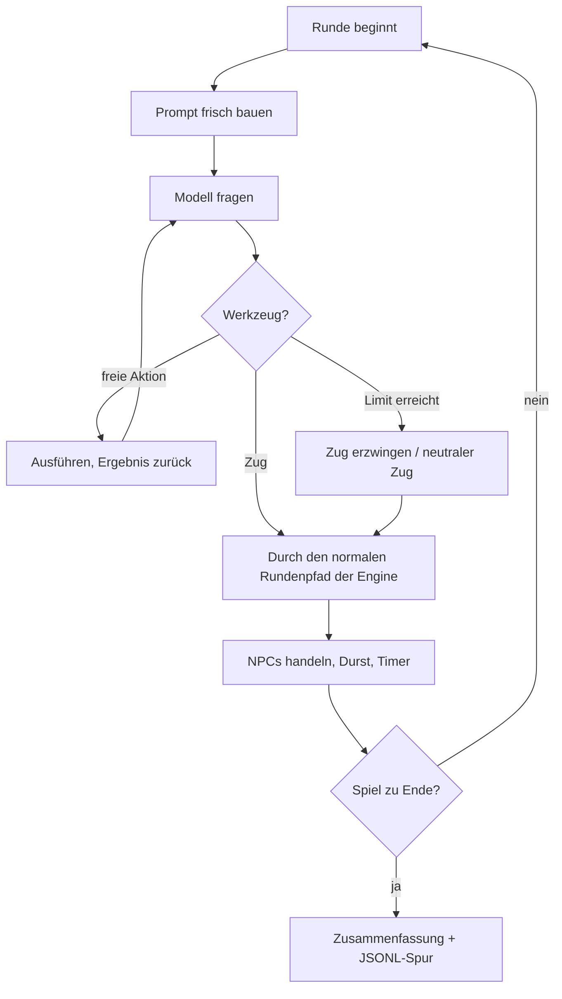

# Der Agent-Spieler — wie er funktioniert (Erklärung)

Lehrmaterial-Dokument zum **Agent-Spieler**: ein KI-Agent spielt das Adventure, und der Browser zeigt live zu.
Alle Verweise zeigen auf das Paket `agent_player/` (Stand 2026-11-11; im Zweifel nach den Funktions-
namen suchen, nicht nach Zeilennummern). Gegenstück zu `docs/ZOMBIE-NPC-erklaert.md`: dort entscheidet ein
Modell **einmal pro Runde**, hier läuft eine **Schleife**.

> **Leitfrage:** Wie funktioniert ein Agent? Und was ändert sich, wenn man die Spielwelt zur
> **Werkzeug-Umgebung** macht — so wie bei Claude Code das Repository die Welt ist und Shell und
> Dateizugriff die Werkzeuge sind?

---

## 1. Was ist ein Agent? (fünf Sätze)

1. Ein Agent ist im Kern eine **Schleife**: Das Modell bekommt eine Situation und eine Liste von Werkzeugen.
2. Es ruft ein Werkzeug auf; der Code führt es aus und gibt das **Ergebnis** zurück.
3. Das Modell sieht das Ergebnis und entscheidet erneut — bis es fertig ist (oder ein Limit greift).
4. Das Modell „handelt“ also nie selbst: **Es bittet, der Code handelt**, und nur der Code entscheidet, was erlaubt ist.
5. Alles andere (Gedächtnis, Planung, Fehlerbehandlung) ist Zubehör um diese Schleife.

Die Schleife steht in **einer** Funktion, `loop.spiele_runde`. Sie ist das Lehrstück dieses Pakets.

---

## 2. Zwei verschachtelte Schleifen

Das Spiel hat Runden (außen). In jeder Runde denkt der Agent in einer eigenen Schleife (innen):

```
   ÄUSSERE SCHLEIFE  runner._spiele_agent              (bis Spielende / Rundenlimit / Stopp)
   ┌──────────────────────────────────────────────────────────────────────────────────┐
   │  Runde n                                                                           │
   │   ┌────────────────────────────────────────────────────────────────────────────┐ │
   │   │ INNERE SCHLEIFE  loop.spiele_runde                                          │ │
   │   │   Prompt frisch bauen (Lage + Notizbuch + letzte Züge)                      │ │
   │   │   ┌─> Modell fragen ──> Werkzeug(e) ausführen ──> Ergebnis zurück ──┐       │ │
   │   │   └──────────────── freie Aktion: nächste Frage ◄────────────────────┘       │ │
   │   │                     ZUG: Runde endet, Kontext wird verworfen                │ │
   │   └────────────────────────────────────────────────────────────────────────────┘ │
   │   Engine: Durst, NPC-Züge (Hund, Zombie), Timer, Game Over   (wie beim Menschen)   │
   └──────────────────────────────────────────────────────────────────────────────────┘
```

Als Mermaid:



Die Grenzen stehen alle in `agent_player/config.py` (Aufrufe pro Runde = 8, Runden pro Spiel = 100,
Verlauf = 10 Runden, Chat-Wortwechsel = 10, optional ein Tokenlimit fürs ganze Spiel).

---

## 3. Freie Aktionen vs. Züge — und warum diese Trennung

Zentrale Designentscheidung (`tools.py`, drei getrennte Listen, im Code kommentiert):

| | **Freie Aktionen** | **Züge** |
|---|---|---|
| Kosten | keine Spielrunde | genau **eine** Runde |
| Die Welt … | bleibt stehen, kein NPC handelt | verändert sich; danach handeln Hund/Zombie, der Durst steigt |
| Beispiele | `situation_lesen`, `inventar_ansehen`, `notizbuch_lesen`, `notizbuch_schreiben`, `spielstand_speichern`, `was_weiss_ich_ueber` | `gehen`, `nehmen`, `ablegen`, `anwenden`, `untersuchen`, `umsehen`, `geben`, `angreifen`, `ansprechen`, `abwarten` |
| Ausführung | direkt in `loop.frei_ausfuehren` | durch **denselben Pfad wie ein Menschenbefehl** (`handle_command` → `execute_single_command`) |

Das ist wie bei Claude Code: Eine Datei **lesen** ändert nichts (frei); einen Befehl **ausführen** schon (Zug).
Die Trennung zwingt das Modell, erst nachzudenken und nachzusehen und **dann** zu handeln.

Jeder Zug hat ein Pflichtargument **`warum`** (ein Satz). Es ist keine Spiellogik, sondern damit Zuschauer
und Log sehen, *warum* der Agent etwas tut. Fehlt es, weist `loop.fuehre_werkzeug_aus` den Aufruf ab.

**Ungültige Aufrufe kosten keine Runde.** `tools.zug_vorbereiten` prüft jeden Zug gegen das, was der Agent
sehen kann (Objekte hier, Wege, Inventar, anwesende Figuren) und liefert eine verständliche Fehlermeldung als
**Werkzeugergebnis** — etwa „'ölkanne' hast du nicht bei dir. Inventar: umschlag, schlüssel.“ Das Modell lernt
daraus und versucht es neu (siehe Spur unten). Auch ein von der Engine als Systemfehler markierter Zug
(`last_command_was_system_error`) kostet keine Runde.

**Warum Verben direkt als Werkzeuge, nicht Freitext an den Parser?** Ein LLM weniger in der Kette (kein
Parse-Fehler, kein „plausibel, aber falsch“ wie der dokumentierte `gehe`-Teleport), klare Fehlermeldungen,
und „Welt = Werkzeuge“ wird sichtbar. Weil die Züge am Ende doch durch dieselbe Engine laufen, entsteht keine
zweite Regelwelt: `runner.fuehre_zug_aus` legt den Zug als `{"function_call": …}` in die Befehlswarteschlange
und ruft `handle_command` auf.

---

## 4. Wahrnehmung und Fairness

Der Agent sieht **nur, was ein Mensch im Browser sähe** (`observation.py`; das Modul hat bewusst keinen
Import von `GameState`):

- **Quelle 1:** `session["state"]` — derselbe Dict, den der Browser bekommt (Ort, Szene, Objekte, Wege,
  Inventar, Durst, Hund/Zombie *anwesend*).
- **Quelle 2:** die Nachrichten, die der Browser bei einem Zug bekam, mitgeschnitten in `session["tap"]`
  (`CommandEngineMixin._send`): Ergebnistext, gelesene Popups (Betriebsanleitung), sichtbare NPC-Meldungen
  (`zombie_event`, Biss, Explosions-Timer, Ausgang des Hundekampfs).

**Nicht** sichtbar: `world.json`, Flags, interne `o_`/`p_`-IDs, Obstruction-Funktionen, der Walkthrough, der
Zustand der NPCs (`zombie_state`, Trust), die PIN, die Debug-Zeilen `dog_message`/`zombie_message`.
Der Agent kennt nur **Rufnamen**; die Übersetzung Rufname → ID macht die Engine.
Das Ziel im Systemprompt (`context.SYSTEM_PROMPT`) ist nur das, was der Spieler zu Beginn liest (Bote,
Umschlag, gerissene Kette) — kein Lösungswissen.

---

## 5. Kontext: frisch pro Runde — statt eines wachsenden Chats

Jede Runde baut den Prompt **neu** (`context.runden_nachricht`): System-Prompt + aktuelle Lage + **Notizbuch** +
die letzten 10 Züge als Einzeiler. Innerhalb der Runde wächst der Kontext mit den Werkzeugergebnissen; nach dem
Zug wird er **verworfen**. Das ist eine bewusste Entscheidung:

- **Kosten:** Ein Chat über 100 Runden würde bei jedem Aufruf *alles* erneut mitschicken.
- **Fokus:** Das Modell soll auf die aktuelle Lage schauen, nicht in alten Szenen versinken.
- **Disziplin:** Wer nichts aufschreibt, vergisst. Das **Notizbuch** (`notebook.py`) ist das einzige
  Langzeitgedächtnis — der Agent muss es selbst pflegen (`notizbuch_schreiben`).

**Vergleich mit dem Zombie** (`npc_zombie_state.py`): Dessen Notizbuch (`self.notes`) wird jeden Zug **komplett
überschrieben** (das Modell schreibt es in `<NOTIZBUCH>`-Tags mit); der Agent **hängt Einträge an**. Beide folgen
dem Muster „Arbeitsgedächtnis außerhalb des Modells“, nur ist es beim Agenten ein *Werkzeug*.

---

## 6. Der Zombie (Ein-Schuss) vs. der Agent-Spieler (Schleife)

| | **Zombie** (HUNTING) | **Agent-Spieler** |
|---|---|---|
| Modellaufrufe pro Runde | **einer** | **mehrere** (bis zu 8 Werkzeugaufrufe + 1) |
| Ausgabe | Text mit Tags `<AKTION>…</AKTION><NOTIZBUCH>…`, vom Code geparst | echte **Function Calls** (strukturiert) |
| Sieht Ergebnisse, bevor er sich entscheidet? | nein — entscheidet blind, sieht das Ergebnis erst nächste Runde | **ja** — freie Aktionen liefern sofort Ergebnisse |
| Aktionsraum | klein (gehen, beißen, …) | alle Verben + Notizbuch + Chat + PIN + Speichern |
| Fehler | der Code fängt ihn ab (Fallback) | Fehlermeldung als Werkzeugergebnis → das Modell korrigiert sich |
| Kosten | gering | deutlich höher (siehe Token-Zähler im Panel) |

Die „Ein-Schuss“-Variante ist die Baseline: *ein Modellaufruf = ein Zug*. Die Schleife ist die Verallgemeinerung
— und die Antwort auf „Warum probiert der Agent nicht einfach erst mal nach, bevor er handelt?“

---

## 7. Gespräche: zwei Modelle verhandeln miteinander

Chats mit Hund und Zombie führt der Agent selbst (`chat.py`): gleicher Aufbau wie `loop.py`, nur mit den Werkzeugen
`sage(text)` und `gespraech_beenden(zusammenfassung)`; Spielzüge sind im Chat nicht erlaubt. Das NPC-seitige
Verhalten bleibt **unverändert** (`whom.chat`, `whom.end_chat`, Trust-Mechanik): Der Agent ersetzt nur die
Eingabe des Menschen. Der Agent (Gemini mit Werkzeugen) spricht mit einem anderen, unabhängigen Prompt.

- Das Chat-Modal im Browser ist im Zuschauermodus nur **Anzeige** (`readonly`); die Zeilen des Agenten erscheinen,
  als hätte ein Mensch sie getippt.
- Beendet wird auf drei Wegen: der Agent ruft `gespraech_beenden`, der NPC schreibt `quit`, oder das Limit (10
  Wortwechsel) greift. In den letzten beiden Fällen fragt die Schleife einmal nach der Zusammenfassung.
- Die **Zusammenfassung wandert automatisch ins Notizbuch** — das ist die „Gelegenheit zum Notieren“.

---

## 8. Das Austauschen der Eingabe: `AgentDialogs`

Alle Stellen, an denen das Spiel auf einen Menschen wartet (Name, PIN, Minispiel, Chat, Game Over), laufen
über ein „Dialog“-Objekt, das die Engine als `dialogs=` bekommt. `AgentDialogs` erbt von `WebDialogs` und
ersetzt:

- **Name:** fest („Agent“, `config.AGENT_SPIELERNAME`).
- **PIN-Pad** (`pin.py`): `pin_eingeben(ziffern)`; der Server prüft `md5(ziffern)` gegen den Hash — wie `pinpad.js`.
  Ein Versuch pro Karteneinsatz; die PIN steht nirgends im Prompt, der Agent muss sie im Notizbuch haben.
- **Minispiel:** entfällt; das Ergebnis wird **gewürfelt** (`WON` = der Hund gewinnt = Spiel verloren). Gewichte
  in `config.MINISPIEL_GEWICHTE`. Ein bewusst einfacher Platzhalter: Geschick spielt keine Rolle mehr.

Das ist ein schönes Beispiel für ein **Port-Muster**: Die Engine fragt nur „den Spieler“; wer das ist, entscheidet
das Objekt, das man hineinreicht.

---

## 9. Zuschauermodus bedienen

Start: Link **„🤖 Agent spielen lassen“** (oder `http://localhost:8000/?mode=agent`). Weitere Parameter:

| URL | Wer spielt |
|---|---|
| `?mode=agent` | Gemini (`config.AGENT_MODELL`, Standard `gemini-2.5-flash`) |
| `?mode=agent&player=fake` | Fake-Modell (kostenlos, feste Antworten) |
| `?mode=agent&player=skript` | Skript-Spieler (feste Befehlsliste, ganz ohne Modell) |
| `…&save=<name>` | ab einem Spielstand **mit** Agentengedächtnis (siehe 10) |

Die normale Oberfläche läuft unverändert weiter; rechts das **Agenten-Panel** (Steuerung bleibt oben stehen):

- **▶ Start / ⏸ Pause / ⏭ Schritt / ⏩ Runde / ⏹ Stopp** und ein Tempo-Regler. **Schritt** = genau *ein*
  Werkzeugaufruf (für den Unterricht das Wichtigste); **Runde** = bis zum nächsten Zug. Steht oben
  „⏳ wartet auf Freigabe“, dann wartet der Agent auf einen Klick (das gilt auch mitten im Gespräch).
- **Protokoll** mit Farben: 🔵 freie Aktion · 🟢 Zug · 🔴 Fehler · 🟣 Chat · 🟠 PIN · grau Modelltext;
  das `warum` jedes Zugs gelb hervorgehoben.
- **Notizbuch**, **Tokens** (Runde/gesamt), Modellaufrufe, Aufrufe/Limit.
- **💬 Hinweis an den Agenten:** ein bewusster Eingriff („Human in the Loop“), er gilt ab der nächsten Runde, steht
  im Prompt als eigener Abschnitt und wird nur einmal verwendet.
- **💾 Speichern / 📂 Laden**, **A− / A+** (Beamer-Zoom).

---

## 10. Spielstände mit Agentengedächtnis

Ein Agent ist mehr als die Spielwelt: Ohne Notizbuch und Verlauf wäre ein geladener Spielstand für ihn ein
Fremder. Deshalb hängt am Spielstand ein optionaler Block `"agent"` (`spielstand.py`, `services/save_load.py`),
mit eigener Formatkennung (`agent-zustand`) und **Version**. Beim Laden wird er **geprüft** (`pruefen`):
falsches Format, zu neue Version oder falsche Typen werden erkannt, und der Spielstand wird dann nicht geladen.

Der Agent hat dazu die freie Aktion **`spielstand_speichern(notiz)`**: vor einer riskanten Entscheidung speichert
er selbst und schreibt eine **Notiz an sein künftiges Ich** („Vorsicht: gleich zünde ich die Sprengladung!“). Nach
dem Laden steht sie einmal prominent im ersten Prompt und bleibt im Notizbuch. Gespeichert wird nur *zwischen*
Zügen. Details: `docs/SAVE-LOAD-DESIGN.md`.

---

## 11. Ein kommentierter Ausschnitt aus einer echten Spur

Aus `agent_runs/2026-11-11_15-09-31.jsonl` (Modell `gemini-2.5-flash`, Hund an; gekürzt). Jede Zeile der Spur ist
ein Ereignis; hier als lesbarer Text. „R“ = Spielrunde (beginnt bei 0).

**Runde 0 — der Zuschauer-Hinweis landet im Notizbuch**

```
[free ] R0  notizbuch_schreiben  text='Hinweis: "Untersuche den Mülleimer im U-Bahnhof, notiere die Geheimzahl, …"'
              -> Notiert.
[move ] R0  gehen  ziel='schuppen'
              warum: Ich suche nach Werkzeugen oder einer Möglichkeit, mein Fahrrad zu reparieren …
              -> Agent ist nun hier: schuppen
```
💡 Der Hinweis kam vom Zuschauer. Der Agent hat ihn **als Erstes ins Notizbuch übernommen** — eine freie Aktion, die
keine Runde kostet. Er hat die Anweisung dann aber nicht verfolgt (er ging zum Schuppen): Hinweise sind
Vorschläge, keine Befehle.

**Runde 1 — Nachsehen ist ein Zug**

```
[text ] R1  Modell: „Ich stehe vor dem verschlossenen Schuppen … Ich fange an, die herumliegenden Objekte zu untersuchen.“
[move ] R1  untersuchen  objekt='blumentopf'
              warum: … zu sehen, ob sich darin etwas Nützliches befindet, wie zum Beispiel ein Schlüssel …
              -> Ein alter Blumentopf – aber warte: **unter dem Blumentopf liegt ein Schlüssel!!!**
```
💡 Die Zeile `[text]` ist der **echte Freitext des Modells** zwischen den Aufrufen, keine erfundene
„Gedankenwiedergabe“. Das `warum` sieht man daneben.

**Runde 2 — ein Gespräch mit dem Hund (NPC-initiiert, mitten im Zug)**

```
[chat ] R2  sage      Agent: Hallo, braver Hund.
                      Hund:  **Wuff!** Du nennst mich "braver Hund"? In dieser verdammten Hitze, mit meinem Magen …
[chat ] R2  sage      Agent: Was fehlt dir, lieber Hund? Kann ich dir helfen?
                      Hund:  **Hechel, hechel!** … ich glaube dir kein Wort mehr, Du!
[chat ] R2  gespraech_beenden
              Zusammenfassung fürs Notizbuch: Der Hund ist hungrig, misstrauisch und glaubt mir kein Wort. …
[move ] R2  nehmen    objekt='schlüssel'
```
💡 Zwei Modelle sprechen miteinander (Agent ↔ Hund-Prompt). Solche Gespräche eröffnet typischerweise der Hund selbst
(„Grrr!“), wenn er angreift; der Chat läuft *innerhalb* des Zugs. Danach steht ein Eintrag im Notizbuch
(`agent_notebook`-Ereignis: „2. Gespräch mit Hund (Runde 2): …“) — und die Runde geht normal weiter.

**Runde 6/7 — Fehler kosten keine Runde, das Modell lernt**

```
[error] R6  geben  an='Hund' objekt='ölkanne'
              -> 'ölkanne' hast du nicht bei dir. Inventar: umschlag, schlüssel.
[move ] R6  nehmen objekt='ölkanne'
[error] R7  anwenden objekt='ölkanne' auf='Hund'
              -> 'Hund' ist weder hier noch in deinem Inventar. Objekte hier: farbeimer, leiter, pinsel, …
[text ] R7  Modell: „Ich habe gelernt, dass ich Objekte nicht auf Figuren anwenden kann. Ich schreibe das in mein Notizbuch.“
[free ] R7  notizbuch_schreiben  text="Hund ist eine Figur, kein Objekt. Ich kann Objekte nicht 'auf' den Hund anwenden."
```
💡 Beide Fehler kosten **keine Runde** (R6 und R7 haben danach einen gültigen Zug). Der Agent schreibt die Lehre
selbst ins Notizbuch — genau der Zweck des Notizbuchs.

**Runde 9–11 — die gefährliche Entscheidung**

```
[move ] R9  anwenden objekt='sprengladung'
              warum: Ich aktiviere die Sprengladung, um den Hund zu vertreiben …
              -> Die Sprengladung ist nun scharf gemacht!
                 ⚠ Das Duell endet unentschieden. …            ← gewürfeltes Minispiel (TIE)
                 ⚠ 💣 Timer: Sprengladung explodiert in 2 Spielzügen in p_innen
[move ] R10 gehen  ziel='schuppen'         -> … explodiert in 1 Spielzügen
[move ] R11 gehen  ziel='felsnische'
              -> ⚠ (((( KABUMM!!! )))) … Folgende Objekte sind pulverisiert worden: … schuppen …
                 Die Sprengladung ist leider am falschen Ort explodiert. Du kannst das Spiel nicht mehr gewinnen.
agent_summary: ergebnis=verloren, runden=11, aufrufe=23, modellaufrufe=23, tokens=48913
```
💡 Der Agent hat sich in Sicherheit gebracht — aber die Sprengladung am **falschen Ort** gezündet und damit den
Schuppen zerstört (Spielregel: nicht mehr gewinnbar). Hier hätte `spielstand_speichern("Vorsicht: Sprengladung
nicht im Schuppen zünden!")` gepasst. Ob der Agent das Adventure löst, ist kein Ziel dieses Projekts;
**wo er hängen bleibt, ist mindestens so lehrreich.**

---

## 12. Experimente

- **Anderes Modell:** `config.AGENT_MODELL` ändern — oder eine zweite Klasse neben `GeminiAgentLLM` in `llm.py`
  schreiben (z. B. Claude über die Anthropic-API). `AgentLLM.frage(system, nachrichten, werkzeuge)` ist die ganze
  Schnittstelle; `loop.py` bleibt unverändert.
- **Anderes Limit:** `MAX_AUFRUFE_PRO_RUNDE`, `MAX_RUNDEN`, `MAX_TOKENS_GESAMT`, `VERLAUF_RUNDEN`
  (z. B. 0 = nur Notizbuch, kein Verlauf).
- **Ohne Notizbuch:** `notizbuch_schreiben` aus `FREIE_AKTIONEN` nehmen — wie weit kommt der Agent dann?
- **Schleife ohne KI:** `./venv/bin/python3 -m agent_player.fake_run` (und mit dem Argument `verzettelt` für das
  Aufruflimit) — dieselbe Schleife, nur kommen die Werkzeugaufrufe aus einer Liste.
- **Anderes Risiko:** `MINISPIEL_GEWICHTE` (z. B. `(1, 3, 2)`: der Hund gewinnt seltener).
- **Eingriff:** Per Hinweisfeld Vorschläge machen — und beobachten, ob und wann der Agent ihnen folgt.

---

## 13. Bekannte Grenzen

- **Kein Beweis fürs Lösen.** Der Agent kann das Adventure lösen oder nicht; kein Abnahmekriterium.
- **Der Vorab-Check ist großzügiger als beim Menschen:** Ein Mensch, der in einen versperrten Weg läuft, verliert
  eine Runde; dem Agenten sagt `tools.zug_vorbereiten` es vorher, ohne Runde.
- **Mehrdeutige Rufnamen** (mehrere Objekte heißen „Schalter“) werden über den ersten Rufnamen aufgelöst, den
  die Beobachtung zeigt.
- **Die Szenenbeschreibung ist LLM-erzeugt** und kann ausschmücken; der Mensch sieht dasselbe. Deshalb steht die
  verlässliche Liste *Objekte hier / Begehbare Wege* immer dabei.
- **Das Minispiel ist gewürfelt**, das PIN-Pad lässt nur einen Versuch pro Karteneinsatz zu.
- **Rundenzählung** beginnt bei 0 (`game.time`); Spur und Panel zeigen dieselbe Zahl.
- **Gesprächsfreigabe:** Im Schritt-Modus braucht auch jede Chat-Äußerung einen Klick (Panel zeigt „wartet“).
- **Kosten:** Eine 11-Runden-Partie hatte 23 Modellaufrufe und ~49 000 Tokens — ein Lauf über 100 Runden ist nicht billig.
- **Nur ein Zuschauer:** Der Browser, der das Spiel startet, ist zugleich Zuschauer (kein Sitzungs-Broadcast).
